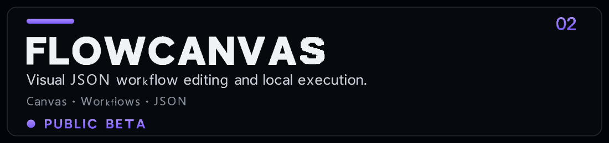
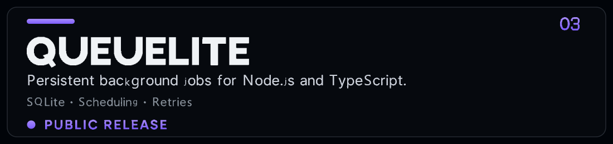

  

  <strong>Building useful software around backend systems, security and developer tooling.</strong>

  Clean architecture · Maintainability · Systems · Security

<!-- ABOUT -->

I build software with a focus on **backend engineering, maintainability, security and understanding how systems actually work**.

I like turning real problems into software that is simple to use, predictable to maintain and technically solid underneath.

Most of what interests me lives somewhere between **software architecture, developer tooling, cybersecurity, Linux and system internals**.

  <code>backend engineering</code>
  &nbsp;
  <code>software architecture</code>
  &nbsp;
  <code>security</code>
  &nbsp;
  <code>linux</code>
  &nbsp;
  <code>developer tooling</code>

<!-- CURRENT WORK -->

  

### RepoDoctor

**Repository analysis for architecture, maintainability and codebase health.**

RepoDoctor is a local CLI for reviewing structural signals in a repository, with evidence, confidence levels and explicit analysis coverage.

It focuses on identifying things such as:

- runtime dependency cycles in TypeScript and JavaScript
- potentially unused files and packages
- large files and functions
- exact token duplication in TypeScript and JavaScript
- identical files and file metrics in other recognized languages
- explainable structural scores with explicit coverage limits

Findings guide investigation; static analysis cannot prove that a candidate file is safe to delete or certify runtime behavior. See the [analysis reference](https://github.com/thebraz/RepoDoctor/blob/main/docs/reference.md) for supported syntax and limits.

  <code>TypeScript</code>
  &nbsp;
  <code>CLI</code>
  &nbsp;
  <code>Static Analysis</code>
  &nbsp;
  <code>Architecture</code>
  &nbsp;
  <code>Developer Tools</code>

  <a href="https://github.com/thebraz/RepoDoctor"><strong>View RepoDoctor →</strong></a>

 

  

### FlowCanvas

**Visual workspace for building and organizing interactive diagrams and workflows.**

FlowCanvas is a local-first visual JSON workflow editor. Build node-based diagrams by adding, dragging, connecting, configuring, duplicating and deleting nodes. Pan and zoom the canvas, select multiple nodes, copy/paste selections and undo/redo edits. Workflows save locally in IndexedDB and support validated JSON import/export.

Its built-in nodes support manual triggers, JSON field updates, field selection, conditional routing, outputs and notes. Execute workflows locally in a worker with pause, resume, step and cancel controls, then inspect node inputs, outputs and the execution timeline. It is intended for exploring JSON transformations and workflow logic; arbitrary scripts, network/API nodes and loops are outside the current beta.

  <code>TypeScript</code>
  &nbsp;
  <code>React</code>
  &nbsp;
  <code>Visual Workflows</code>
  &nbsp;
  <code>JSON</code>
  &nbsp;
  <code>Local-first</code>

  <a href="https://github.com/thebraz/FlowCanvas"><strong>View FlowCanvas →</strong></a>

 

  

### QueueLite

**Lightweight queue management and background job processing.**

QueueLite is a persistent background job queue for Node.js and TypeScript, backed by a local SQLite file. Enqueue JSON jobs with priorities, delays or scheduled times, then process them through registered handlers with bounded concurrency. Jobs move from pending to active and then completed or failed, with configurable retries/backoff, retained failure history, manual retry and pending-job cancellation.

Renewable leases support crash recovery within a finite attempt budget. The SDK and inspection CLI expose job state and diagnostics, while workers support pause/resume and graceful shutdown. It is intended for application background tasks such as notifications and account preparation on one host. External effects must be idempotent: recovery can repeat work, and exactly-once execution and multi-host distribution are not provided.

  <code>TypeScript</code>
  &nbsp;
  <code>Node.js</code>
  &nbsp;
  <code>SQLite</code>
  &nbsp;
  <code>Background Jobs</code>
  &nbsp;
  <code>CLI</code>

  <a href="https://github.com/thebraz/QueueLite"><strong>View QueueLite →</strong></a>

<!-- TOOLBOX -->

<table align="center">
  <tr>
    <td align="center"><strong>Languages</strong></td>
    <td align="center"><strong>Backend</strong></td>
    <td align="center"><strong>Data</strong></td>
    <td align="center"><strong>Systems</strong></td>
  </tr>
  <tr>
    <td align="center">
      TypeScript 
      Java 
      C#
    </td>
    <td align="center">
      Node.js 
      APIs 
      Backend Architecture
    </td>
    <td align="center">
      PostgreSQL 
      Prisma 
      SQL
    </td>
    <td align="center">
      Linux 
      Docker 
      Git
    </td>
  </tr>
</table>

  
    I care more about understanding the tools I use than collecting as many technologies as possible.
  

<!-- GITHUB -->

I use GitHub as a place for projects that are meant to become **actual software**, not just code dumped into a repository.

Things I care about when building:

- clear project structure
- understandable architecture
- useful documentation
- maintainable code
- reproducible setup
- intentional dependencies
- meaningful releases
- software that solves a real problem

  <strong>Current direction</strong>

  <code>Developer Tools</code>
  &nbsp;
  <code>Backend Systems</code>
  &nbsp;
  <code>Security</code>
  &nbsp;
  <code>Open Source</code>

<!-- FOOTER -->

  

  BUILD · UNDERSTAND · IMPROVE

