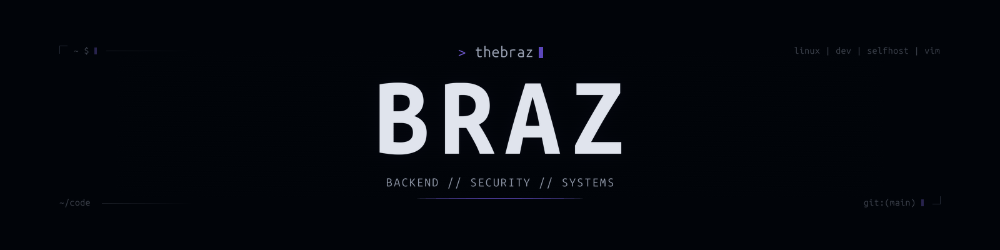
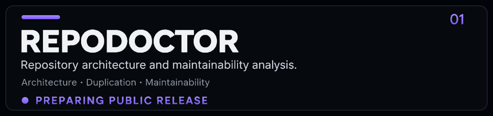
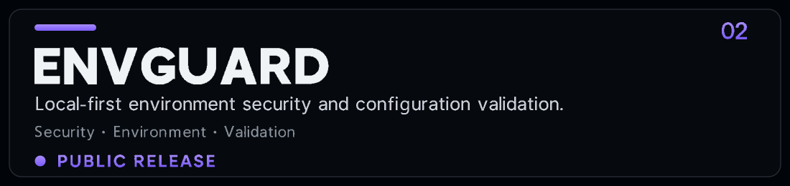

  

  <strong>Building useful software around backend systems, security and developer tooling.</strong>

  Clean architecture · Maintainability · Systems · Security

<!-- ABOUT -->

I build software with a focus on **backend engineering, maintainability, security and understanding how systems actually work**.

I like turning real problems into software that is simple to use, predictable to maintain and technically solid underneath.

Most of what interests me lives somewhere between **software architecture, developer tooling, cybersecurity, Linux and system internals**.

  <code>backend engineering</code>
  &nbsp;
  <code>software architecture</code>
  &nbsp;
  <code>security</code>
  &nbsp;
  <code>linux</code>
  &nbsp;
  <code>developer tooling</code>

<!-- CURRENT WORK -->

  

### RepoDoctor

**Repository analysis for architecture, maintainability and codebase health.**

RepoDoctor is a local CLI for reviewing structural signals in a repository, with evidence, confidence levels and explicit analysis coverage.

It focuses on identifying things such as:

- runtime dependency cycles in TypeScript and JavaScript
- potentially unused files and packages
- large files and functions
- exact token duplication in TypeScript and JavaScript
- identical files and file metrics in other recognized languages
- explainable structural scores with explicit coverage limits

Findings guide investigation; static analysis cannot prove that a candidate file is safe to delete or certify runtime behavior. See the [analysis reference](https://github.com/thebraz/RepoDoctor/blob/main/docs/reference.md) for supported syntax and limits.

  <code>TypeScript</code>
  &nbsp;
  <code>CLI</code>
  &nbsp;
  <code>Static Analysis</code>
  &nbsp;
  <code>Architecture</code>
  &nbsp;
  <code>Developer Tools</code>

  <a href="https://github.com/thebraz/RepoDoctor"><strong>View RepoDoctor →</strong></a>

 

  

### EnvGuard

**Local-first environment security and configuration validation for modern codebases.**

EnvGuard is a developer security CLI built to detect unsafe environment configuration before it becomes a production problem.

It analyzes the relationship between source code, environment contracts, Git configuration and sensitive values to surface issues such as:

- environment variables used in code but missing from the expected contract
- unused or inconsistent environment definitions
- hardcoded secrets
- weak or unsafe secret values
- sensitive `.env` files accidentally tracked by Git
- secrets exposed through client-side environment variables
- malformed or conflicting environment configuration
- runtime variables that violate required, prohibited or typed schema rules

The goal is to keep environment configuration **predictable, auditable and safe without sending project data anywhere**.

  <code>TypeScript</code>
  &nbsp;
  <code>CLI</code>
  &nbsp;
  <code>Security</code>
  &nbsp;
  <code>Static Analysis</code>
  &nbsp;
  <code>DevSecOps</code>

  <a href="https://github.com/thebraz/EnvGuard"><strong>View EnvGuard →</strong></a>

<!-- TOOLBOX -->

<table align="center">
  <tr>
    <td align="center"><strong>Languages</strong></td>
    <td align="center"><strong>Backend</strong></td>
    <td align="center"><strong>Data</strong></td>
    <td align="center"><strong>Systems</strong></td>
  </tr>
  <tr>
    <td align="center">
      TypeScript 
      Java 
      C#
    </td>
    <td align="center">
      Node.js 
      APIs 
      Backend Architecture
    </td>
    <td align="center">
      PostgreSQL 
      Prisma 
      SQL
    </td>
    <td align="center">
      Linux 
      Docker 
      Git
    </td>
  </tr>
</table>

  
    I care more about understanding the tools I use than collecting as many technologies as possible.
  

<!-- GITHUB -->

I use GitHub as a place for projects that are meant to become **actual software**, not just code dumped into a repository.

Things I care about when building:

- clear project structure
- understandable architecture
- useful documentation
- maintainable code
- reproducible setup
- intentional dependencies
- meaningful releases
- software that solves a real problem

  <strong>Current direction</strong>

  <code>Developer Tools</code>
  &nbsp;
  <code>Backend Systems</code>
  &nbsp;
  <code>Security</code>
  &nbsp;
  <code>Open Source</code>

<!-- FOOTER -->

  

  BUILD · UNDERSTAND · IMPROVE

